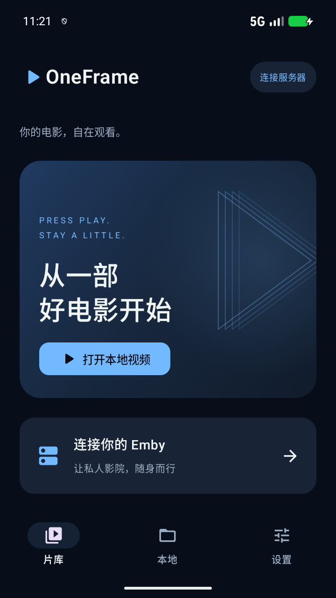
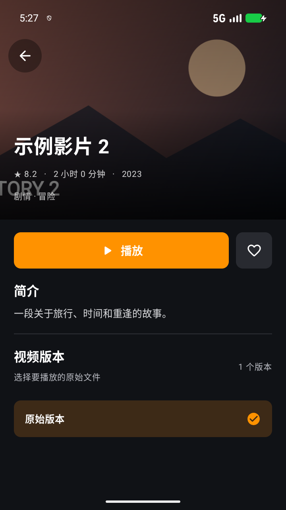
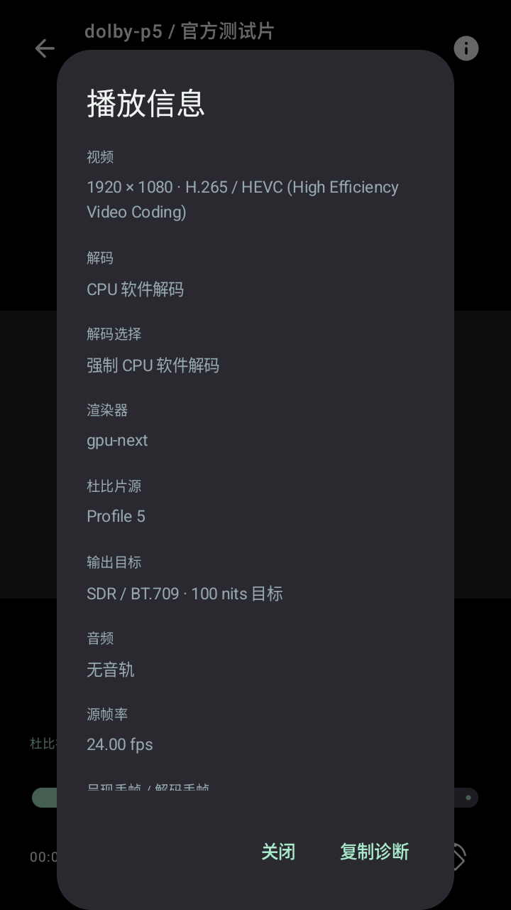

# OneFrame

Android 原生 Emby 播放器的首个可运行原型。手机、平板优先，重点验证没有杜比解码能力的设备通过软件处理 Dolby Vision 片源。

仓库：[showcode1024/OneFrame](https://github.com/showcode1024/OneFrame)。

当前版本：**0.1.6-alpha**。启动时可自动检查 GitHub Release，发现新版本后可打开浏览器下载。此前的播放路径与验证范围见 [0.1.2 验证记录](docs/VALIDATION-0.1.2.md)。

## 运行

- Android 8.0 / API 26 及以上，当前 APK 包含 arm64-v8a 与 x86_64。
- GPU 需支持原生库要求的 OpenGL ES 功能；CPU 软解仍需要 GPU 完成颜色处理和显示。
- 从 [Releases](https://github.com/showcode1024/OneFrame/releases) 的 **Assets** 下载 `OneFrame-版本号.apk` 安装，源代码压缩包不是安装包。打开本地视频或输入 HTTP/HTTPS 播放地址。
- 首次切换到 Release 的项目专用签名包，不能直接覆盖早期本地开发签名或临时 CI debug 包。请先保存服务器信息，再自行卸载旧测试版并安装；后续同签名、版本号递增的 Release 可以覆盖升级。
- 从包含更新功能的版本起，默认在启动时检查 GitHub Release（没有新版本时至少间隔 6 小时），也可在「设置 → 软件更新」关闭自动检查或手动检查。预览版会接收预览和正式版本，正式版仅接收正式版。选择更新后会打开官方 GitHub 下载链接，由浏览器下载，并由 Android 系统确认安装；应用不自行下载或安装 APK。
- 0.1.1 默认优先系统解码底层视频，再由 libplacebo 处理颜色，固定输出 SDR / BT.709；仍保留强制 CPU 软解选项。
- 升级会保留明确设置过的 CPU 开关。如需要测试自动模式，请关闭“强制 CPU 软件解码”，退出播放后重开视频。系统解码无法使用时可能回退 CPU，界面会显示实际路径。
- 点击播放页右上角的信息按钮查看真实路径并复制诊断。
- 设置里的「轻量画面缩放」降低 GPU 缩放负载，画面细节可能变化；不能保证解决 CPU 软解瓶颈。「实验性系统直连解码」优先尝试 `mediacodec`，并停用 P5 自动保色回退，可能导致严重偏色或播放失败；默认关闭，需重开视频，效果和色彩必须在具体设备上验证。关闭后恢复默认策略。强制 CPU 软解优先级更高。
- 双击画面左侧/右侧后退/前进 10 秒；支持进度拖动、速度调整、内嵌音轨字幕选择、字幕延迟、横竖屏。
- 退出播放会保存本地续播位置。后台播放与画中画尚未实现，离开前台会暂停。

## 杜比支持的准确范围

接入 FFmpeg 软件解码与 libplacebo / gpu-next 渲染。目标是处理杜比片源的颜色和亮度并映射到 SDR 屏幕，不能让 SDR 屏拥有 HDR 的物理亮度或色域。

P5、P8.1、P8.4 是首批验证对象。Profile 7 FEL 完整增强层重建未实现/未验收，不能将基础层播放视为完整支持。

音频当前为 FFmpeg 普通声道解码后输出双声道 PCM。**未实现 Atmos 对象解码、头部跟踪或空间渲染**，不能将声音正常称作完整 Atmos 支持。

模拟器测试只能证明样片被识别并通过相应路径输出画面；不代表颜色精度认证、任意片源兼容或真实手机 4K 实时性能。详见 [当前验证记录](docs/VALIDATION-0.1.2.md)、[0.1.1 记录](docs/VALIDATION-0.1.1.md) 和 [0.1.0 历史记录](docs/VALIDATION.md)。

## Emby

支持添加、切换和移除多个服务器账号；展示继续观看、最近添加与媒体库，浏览目录、搜索并查看影片详情。可选择同一影片下服务器返回的不同视频版本，播放器显示所选版本，并上报播放开始、进度与停止。

- 保留反向代理路径，例如 `https://example.com/media/emby`。
- Token 用 Android Keystore 保护的 AES-GCM 加密保存，不保存账号密码。
- 版本列表来自 Emby 的 PlaybackInfo；服务器没有归并为同一影片的文件会作为独立条目显示。不可直放的版本会列出但无法选择。播放时重新确认所选源，不自动切换文件或请求转码。
- 网络视频通过随机路径的本机回环转发器进入原生播放器，避免远端 Token 出现在原生播放 URL 日志中；跨站重定向不携带 Emby Token，HTTPS 证书正常校验。
- 支持可信局域网 HTTP；使用 HTTP 时账号和视频仍会明文经过网络，界面会提示。
- 暂不支持 Emby Connect、多服务器内容同时聚合、Live TV、离线下载和完整外置字幕发现。
- 当前没有用户的真实服务器凭据，Emby 接口通过 MockWebServer 验证，真实服务器联调待完成。

## 升级兼容

当前代码命名空间为 `io.github.showcode1024.oneframe`。安装标识暂时保留 `dev.prism.player`，本地偏好和密钥别名沿用早期标识，以便同签名 APK 覆盖安装并保留 Emby 会话和续播记录。

## 开发与构建

JDK 17、Android SDK Platform 36。Android Studio 打开本目录，等待 Gradle 同步即可。Gradle Wrapper 固定 8.13 并校验官方 SHA-256；AGP 8.13.2、Kotlin 2.2.20、libmpv Android 1.0.0。

Windows：

```powershell
.\tools\build.ps1 -SdkRoot 'C:\path\to\Android\Sdk' -JavaHome 'C:\path\to\jdk-17'
```

也可以直接运行：

```powershell
.\gradlew.bat :app:assembleDebug :app:testDebugUnitTest :app:lintDebug
```

连接设备并运行 UI 与实际杜比样片测试（脚本下载 Dolby 公开测试图，不会将它们打入正式 APK）：

```powershell
.\tools\test-device.ps1 -SdkRoot 'C:\path\to\Android\Sdk' -Serial 'your-device-serial'
```

首次构建需要连接 Google Maven 与 Maven Central。若发生 TLS/下载失败，先修复网络或重试，不关闭证书校验。

仓库有两个工作流：`Android build` 在分支更新时构建 debug 测试产物；`Publish Android release` 在推送 `v版本号` 标签时，由 GitHub 从源码构建、使用项目固定签名、验证并自动上传 APK 和 SHA-256 文件到 Releases。发布说明放在 `docs/releases/v版本号.md`，标签必须与 `versionName` 一致。

发布签名通过仓库的四个 Actions Secrets 提供：`ONEFRAME_KEYSTORE_BASE64`、`ONEFRAME_STORE_PASSWORD`、`ONEFRAME_KEY_ALIAS`、`ONEFRAME_KEY_PASSWORD`。私钥和密码不进入 Git，也不包含在 APK 内。首次配置后不要随意更换，否则后续包将无法覆盖升级。更新版本时同时递增 `versionCode` 和 `versionName`，提交发布说明，再推送对应标签。

## 代码位置

```text
app/src/main/java/io/github/showcode1024/oneframe/
  MainActivity.kt / MainViewModel.kt   文件选择、片库状态、导航
  ui/                                Compose 手机和平板自适应界面
  player/                            原生播放、生命周期、音频焦点、系统媒体控制
  data/EmbyClient.kt                  认证、媒体库、播放协商、进度上报
  data/StreamRelay.kt                 保留 Range 的本机流转发、凭据隔离
  data/LocalStore.kt                  观看记录、偏好、加密账号会话
```

该版本为 alpha，适合测试。SDR 输出目标不变，尚未新增 P7 FEL 完整重建或 Atmos 对象渲染。后续开发重点：真实设备画质与性能、P7 FEL、Atmos 对象渲染、完整 Emby 字幕支持、平板精细布局、播放器服务与画中画。

原生库来源与相关许可证见 [THIRD_PARTY.md](THIRD_PARTY.md)。

## 界面预览

以下为 OneFrame 的实际模拟器截图。



影片详情和版本选择（模拟服务器示例数据）：




